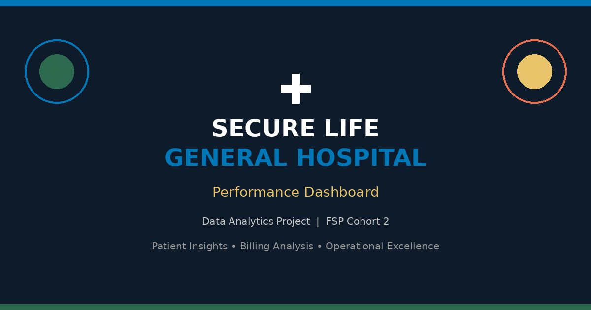
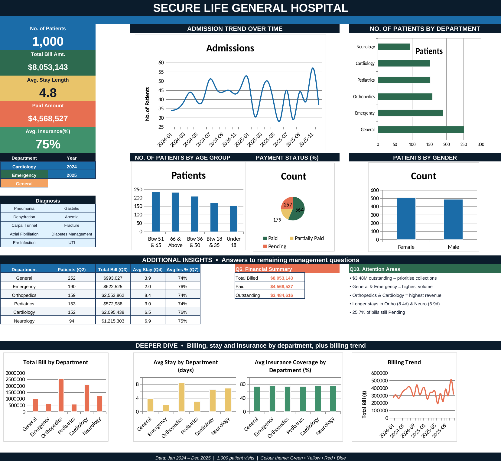

<div align="center">



# 🏥 Secure Life General Hospital — Performance Dashboard

**Data Analytics Project · FSP Cohort 2**


*Patient Insights • Billing Analysis • Operational Excellence*

</div>

---

## 📑 Table of Contents

1. [Introduction](#1-introduction)
2. [About the Dataset](#2-about-the-dataset)
3. [Problem Statement](#3-problem-statement)
4. [Dashboard Visualization](#4-dashboard-visualization)
5. [Key Insights](#5-key-insights)
6. [Recommendations](#6-recommendations)
7. [Conclusion](#7-conclusion)
8. [Repository Contents](#8-repository-contents)
9. [How to Use](#9-how-to-use)
10. [Author](#10-author)

---

## 1. Introduction

This project presents a comprehensive performance dashboard developed for **Secure Life General Hospital**. Hospital management observed changes in patient admissions, outstanding medical bills, and variations in insurance coverage across departments.

The goal of this analysis is to transform raw **patient admission, billing, and insurance data** into clear, actionable insights that support better operational and financial decision-making.

Using **Microsoft Excel**, an interactive dashboard was built to answer key management questions and highlight areas requiring attention. The dashboard uses a distinctive colour theme of **green, yellow, red, and blue** for visual clarity and professional presentation.

---

## 2. About the Dataset

The dataset contains **1,000 patient visit records** covering **January 2024 to December 2025**. Each row represents one patient visit (a single patient may appear more than once).

| Field | Description |
|---|---|
| **Patient ID** | Unique identification for each visit |
| **Patient Name** | Name of the patient |
| **Age** | Patient age in years at the time of visit |
| **Gender** | Male / Female |
| **Admission Date & Discharge Date** | Used to calculate Length of Stay |
| **Department** | Cardiology, Emergency, General, Neurology, Orthopedics, Pediatrics |
| **Diagnosis** | Medical condition recorded |
| **Total Bill Amount** | Total charges for the visit |
| **Insurance Coverage (%)** | Percentage of the bill covered by insurance |
| **Payment Status** | Paid, Partially Paid, or Pending |

---

## 3. Problem Statement

Management lacks a consolidated view of operational and financial performance. They need clear answers to the following questions:

1. How many patient visits has the hospital recorded?
2. Which departments receive the highest number of patients?
3. Which departments generate the highest total bills?
4. What is the average length of stay across different departments?
5. What proportion of bills are Paid, Pending, or Partially Paid?
6. How much has the hospital billed and how much remains outstanding?
7. How does insurance coverage vary across departments and diagnoses?
8. Which age groups account for the highest number of visits?
9. How do admissions and billing amounts change over time?
10. Which areas may require management attention?

---

## 4. Dashboard Visualization



The interactive Excel dashboard contains:

- 🔢 **Five KPI cards:** Total Visits, Total Bill, Avg Stay, Paid Amount, Avg Insurance
- 💰 **Q6 Financial Summary box:** Total Billed, Paid and Outstanding amounts
- 📋 **Department performance table:** Patients, Total Bill, Avg Stay, Avg Insurance %
- 📊 **9 charts** covering all key questions:
  - Admissions Trend (line)
  - Patients by Department (bar)
  - Patients by Age Group (column)
  - Payment Status (pie)
  - Patients by Gender (column)
  - *Deeper Dive row:* Bill by Department, Avg Stay by Department, Insurance by Department, Billing Trend
- 🎯 **Q10 Attention Areas box:** five management takeaways
- 🎨 **Colour theme:** Green, Yellow, Red, and Blue for visual distinction and a professional look

---

## 5. Key Insights

### 📌 At a Glance

| Metric | Value |
|---|---|
| Total Visits | **1,000** |
| Total Billed | **$8.05M** |
| Paid Amount | **$4.57M** |
| Outstanding Amount | **$3.48M** |
| Average Length of Stay | **4.8 days** |
| Average Insurance Coverage | **75%** |

### 🔍 Findings

- **Total Visits:** 1,000 patient visits recorded between Jan 2024 and Dec 2025.
- **Busiest Departments:** General (252 visits) and Emergency (190 visits) handle the highest volume.
- **Highest Revenue Departments:** Orthopedics ($2.55M) and Cardiology ($2.10M) generate the largest total bills despite lower patient counts.
- **Average Length of Stay:** Overall 4.8 days. Orthopedics (8.4 days) and Neurology (6.9 days) have the longest stays; Emergency is shortest (2.0 days).
- **Payment Status:**

  | Status | Share |
  |---|---|
  | ✅ Paid | 56.4% |
  | 🟡 Partially Paid | 17.9% |
  | 🔴 Pending | 25.7% |

- **Financial Snapshot:** Total billed = $8.05M, Paid = $4.57M, Outstanding = $3.48M (significant cash-flow exposure).
- **Insurance Coverage:** Average 75%, relatively consistent across departments (73–76%).
- **Age Groups:** Highest visits from 51–65 (235) and 66+ (232). Under-18 accounts for 153 visits.
- **Trends:** Monthly admissions and billing fluctuate, with noticeable peaks (e.g., November 2025). Capacity planning is required for peak periods.

---

## 6. Recommendations

| # | Focus Area | Recommendation |
|---|---|---|
| 1 | **Collections** | Prioritise recovery of the $3.48M outstanding. Set up dedicated follow-up for Pending and Partially Paid cases. |
| 2 | **Staffing & Capacity** | Ensure adequate staffing and resources for General and Emergency, the two highest-volume units. |
| 3 | **Length-of-Stay Review** | Investigate longer stays in Orthopedics and Neurology to improve bed turnover and reduce costs. |
| 4 | **Insurance Verification** | Strengthen insurance verification at admission to reduce future outstanding balances. |
| 5 | **Geriatric Services** | With over 45% of visits from patients aged 51+, expand services for chronic and age-related conditions. |
| 6 | **Peak-Period Planning** | Use monthly trend data to forecast staffing and resource needs for high-admission months. |

---

## 7. Conclusion

The Secure Life General Hospital Performance Dashboard successfully transforms raw patient data into clear visual insights that answer all ten management questions. The analysis reveals strong patient volume in General and Emergency departments, high revenue contribution from Orthopedics and Cardiology, and a material outstanding balance that requires immediate attention.

By implementing the recommendations above, particularly around collections, capacity planning, and length-of-stay management, the hospital can improve both operational efficiency and financial health. The dashboard provides a solid foundation for ongoing performance monitoring and data-driven decision-making.

---

## 8. Repository Contents

```
📦 Eunice_Marfo_Fadaqa_1_project
 ┣ 📄 README.md                                      # Project documentation (this file)
 ┣ 📊 SECURE_LIFE_GENERAL_HOSPITAL_Dashboard.xlsx    # Finished Excel dashboard (data + summary + dashboard)
 ┣ 📘 Excel_Dashboard_Build_Guide.pdf                # Beginner guide: rebuild the dashboard step by step
 ┣ 📝 GitHub_ReadMe_File.docx                        # Full project write-up
 ┣ 🖼️ Introductory_Image.png                         # Project banner
 ┣ 🖼️ Screenshot_of_Dashboard.png                    # Dashboard preview
 ┗ 📁 Practice_Kit
    ┣ 📊 Practice_Workbook_START_HERE.xlsx           # Raw data + empty sheets to practise on
    ┗ 📄 hospital_patient_data_raw.csv               # The same 1,000 records as a CSV file
```

---

## 9. How to Use

1. Download or clone this repository.
2. Open **`SECURE_LIFE_GENERAL_HOSPITAL_Dashboard.xlsx`** in Microsoft Excel.
3. Explore the KPI cards, department table, and charts to review hospital performance.

> 💡 **Requirements:** Microsoft Excel (2016 or later recommended).

### 🛠️ Want to rebuild it yourself?

1. Open **[`Excel_Dashboard_Build_Guide.pdf`](Excel_Dashboard_Build_Guide.pdf)**, a beginner-friendly guide with 32 numbered steps that builds the whole dashboard, all 9 charts included, with every formula, colour code, chart setting, checkpoint and an answer key.
2. Open **`Practice_Kit/Practice_Workbook_START_HERE.xlsx`**. It already contains the 1,000 raw records plus empty *Dashboard* and *Summary Data* sheets.
3. Follow the guide from Step 3 onwards, then compare your result with the finished workbook.

---

## 10. Author

**Eunice Maafia Marfo**
Computer Engineering Student, University of Ghana

📧 [emmarfo@st.ug.edu.gh](mailto:emmarfo@st.ug.edu.gh)

---

<div align="center">

*Data Analytics Project · FSP Cohort 2 · Secure Life General Hospital*

⭐ If you found this project useful, consider giving it a star!

</div>
